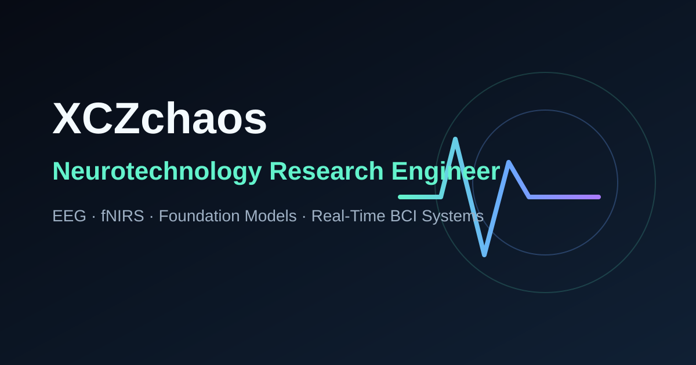

# XCZchaos · Signal notebook

[](https://xczchaos.github.io/)

[个人主页 / Portfolio](https://xczchaos.github.io/) · [NeuroFlow v0.2](https://github.com/XCZchaos/NeuroFlow/tree/v0.2) · [邮件联系](mailto:asherxiong552@gmail.com)

这里记录我在可穿戴生理信号、脑机接口和开源分析工具上的工作。首页可以切换中文和英文，查看项目案例，或比较 EEG、PPG 与 fNIRS 三种模拟波形。欢迎联系我组队参加 BCI 比赛、交流研究，或一起开发开源项目。

The portfolio brings together wearable signal processing, engineering case studies, and NeuroFlow. The waveform examples are synthetic. I welcome research collaborations, BCI competition teammates, and open-source contributors.

## 脑机接口专栏 / Reading series

以下链接直达个人网站的中文原文，包含推导、配图、代码示例和参考资料。

1. [脑机接口的基础概念与发展史](https://xczchaos.shamboo2003.chatgpt.site/articles/bci/)
2. [EEG 脑电信号的基础原理与分析](https://xczchaos.shamboo2003.chatgpt.site/articles/eeg/)
3. [从原始脑电到可分析数据：EEG 信号预处理方法](https://xczchaos.shamboo2003.chatgpt.site/articles/preprocessing/)
4. [从波形到机器学习：EEG 信号特征提取方法](https://xczchaos.shamboo2003.chatgpt.site/articles/features/)
5. [从 EEG 波形到结果：CNN 如何学习脑电特征](https://xczchaos.shamboo2003.chatgpt.site/articles/cnn/)
6. [从注意力机制到脑电解码：Transformer 的 EEG 特征学习](https://xczchaos.shamboo2003.chatgpt.site/articles/transformer/)
7. [从睡眠结构到睡眠分期](https://xczchaos.shamboo2003.chatgpt.site/articles/sleep/)

## 本地预览 / Local preview

```sh
python3 -m http.server 8000
```

Open `http://localhost:8000`. The site is static: `index.html` holds the content, `styles.css` the layout, `i18n.js` the Chinese translations, and `script.js` the interactions. Images are served from `assets/`. Run `python3 tools/refine_portfolio.py` to check the links and assets.

For GitHub Pages, use **Deploy from a branch → main → / (root)**. The other branches are not the portfolio publishing source.
